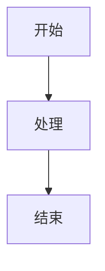

## 简介

欢迎使用 Doki 引擎！本指南将帮助您快速上手 Doki 引擎的基本使用方法。

## 安装

### 前提条件

- Node.js 20+
- pnpm
- Git

### 安装步骤

1. 克隆仓库

```bash
git clone https://github.com/doki-engine/doki-engine.git
cd doki-engine
```

2. 安装并构建

```bash
pnpm install
pnpm build
```

3. 运行测试

```bash
pnpm test
```

## 基本使用

### 创建第一个站点

```bash
npx doki init my-site
cd my-site
npx doki build
```

生成结果默认在 `dist/` 目录。

## 核心功能

### 语法高亮

Doki 支持多种编程语言的语法高亮：

```rust
fn main() {
    println!("Hello, Doki!");
}
```

### 数学公式

使用 LaTeX 语法编写数学公式：

$$E = mc^2$$

### 图表

使用 Mermaid 绘制图表：



## 高级功能

### 主题定制

您可以通过 `doki.toml` 配置文件定制文档主题：

```toml
[theme]
name = "default"
primary_color = "#3498db"
```

### 插件系统

Doki 支持插件扩展，您可以通过以下方式添加插件：

```toml
[plugins]
enabled = ["math", "mermaid"]
```

## 常见问题

### 构建失败

如果构建失败，请检查：
- Node.js / pnpm 版本是否符合要求
- 依赖项是否正确安装（`pnpm install`）
- 模板与内容语法是否正确

### 性能优化

对于大型文档，您可以：
- 启用增量构建
- 调整缓存设置
- 使用并行构建

## 下一步

- 查看 [语法指南](../grammar/index.md) 了解更多 Doki 语法
- 阅读 [高级教程](../guide/index.md) 掌握高级功能
- 加入 [社区](https://github.com/doki-engine/doki-engine/discussions) 与其他用户交流

---

祝您使用 Doki 引擎愉快！
